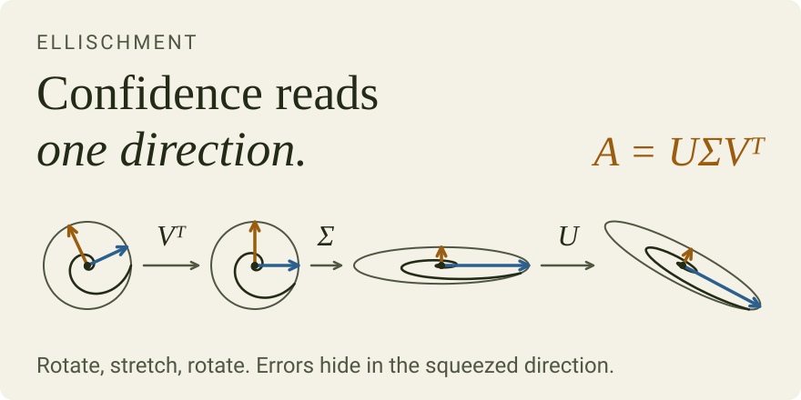
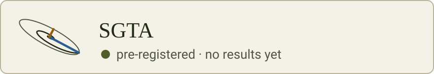
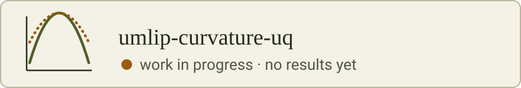
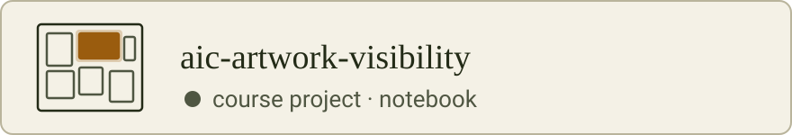

<picture>
  <source media="(prefers-color-scheme: dark)" srcset="assets/hero-dark.svg">
  
</picture>

**Vasilisa Popova.** I study where a model's confidence and the truth come apart: LLM error detection, uncertainty quantification, evaluation tooling. Second-year student, Mathematics and Computer Science, Central University.

Open to commissions: Python backends, automation and websites. [ellischment.ru](https://ellischment.ru) · [ellischment.work@gmail.com](mailto:ellischment.work@gmail.com) · [По-русски](README.ru.md)

*Why this picture.* A linear map stretches some directions and squeezes others, and a single confidence score follows the stretched one. My question is what the squeezed directions hold and whether errors hide there. It is an analogy for the work, not a result.

## Research in progress

<a href="https://github.com/ellischment/sgta"><picture>
  <source media="(prefers-color-scheme: dark)" srcset="assets/strips/sgta-dark.svg">
  
</picture></a>

Does the *stability* of an LLM's hidden state tell a confident error from a confident correct answer, where hidden-state geometry cannot? A frozen protocol with thresholds and kill rules, code, tests and CI. No results on real data yet.

<a href="https://github.com/ellischment/umlip-curvature-uq"><picture>
  <source media="(prefers-color-scheme: dark)" srcset="assets/strips/umlip-curvature-uq-dark.svg">
  
</picture></a>

Can spread-based uncertainty detect systematic phonon softening shared by several universal ML interatomic potentials? Pipeline and tests. No results reported yet.

## Finished work

<a href="https://github.com/ellischment/llm-trace-eval"><picture>
  <source media="(prefers-color-scheme: dark)" srcset="assets/strips/llm-trace-eval-dark.svg">
  
</picture></a>

What does an LLM eval look like through OpenTelemetry traces instead of one accuracy number? A small working scaffold with a 50-example synthetic dataset, 15 tests and CI. Not a benchmark.

<a href="https://github.com/ellischment/aic-artwork-visibility"><picture>
  <source media="(prefers-color-scheme: dark)" srcset="assets/strips/aic-artwork-visibility-dark.svg">
  
</picture></a>

Which artworks of the Art Institute of Chicago stay unseen, judging by metadata alone? Course project, December 2025: CatBoost with SHAP analysis in one notebook.

## How I work

- **Fix the test before the data.** SGTA fixes its hypotheses and thresholds first, and CI fails if the protocol changes without its hash.
- **Say what is not there.** Each repository lists what is unfinished or not implemented.
- **A failing call must not hide a run.** In llm-trace-eval a failed model call becomes an `ERROR` span and a wrong answer, and the run continues.

## Build with me

I build backends, automation and websites on commission in Python and Docker. Client work is private; see [ellischment.ru](https://ellischment.ru).
