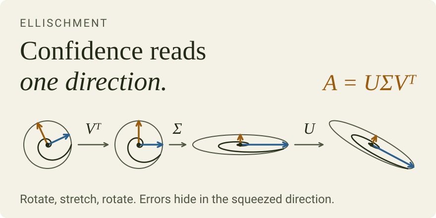

<picture>
  <source media="(prefers-color-scheme: dark)" srcset="assets/hero-dark.svg">
  
</picture>

**Василиса Попова.** Изучаю, где уверенность модели расходится с правдой: поиск ошибок LLM, оценка неопределённости, инструменты для eval. Второй курс, «Математика и компьютерные науки», Центральный университет.

[ellischment.ru](https://ellischment.ru) · [ellischment.work@gmail.com](mailto:ellischment.work@gmail.com) · [English](README.md)

## Работы

| Проект | Вопрос | Статус |
|---|---|---|
| [**SGTA**](https://github.com/ellischment/sgta-research-preview) | Отличает ли *устойчивость* скрытого состояния LLM уверенную ошибку от уверенного верного ответа там, где не помогает геометрия состояний? | Предрегистрированный протокол с порогами и правилами опровержения, хэш проверяется в CI. Код и тесты. Результатов на реальных данных пока нет. |
| [**umlip-curvature-uq**](https://github.com/ellischment/umlip-curvature-uq) | Видит ли оценка неопределённости по разбросу моделей систематическое занижение частот фононов у универсальных ML-потенциалов? | Пайплайн и тесты. Результатов пока нет. |
| [**llm-trace-eval**](https://github.com/ellischment/llm-trace-eval) | Как выглядит eval LLM через трассы OpenTelemetry, а не через один процент accuracy? | Небольшой работающий каркас, синтетический датасет на 50 примеров, тесты. Не бенчмарк. |
| [**cu_final_ml_project**](https://github.com/ellischment/cu_final_ml_project) | Какие произведения Art Institute of Chicago останутся невидимыми, если судить только по метаданным? | Учебный проект, декабрь 2025: CatBoost и анализ SHAP в одном ноутбуке. |

## Как я работаю

- **Тест раньше данных.** В SGTA гипотезы и пороги записаны заранее, CI падает, если протокол изменён без хэша.
- **Говорить, чего нет.** В каждом репозитории перечислено, что не доделано или не реализовано.
- **Упавший вызов не прячет прогон.** В llm-trace-eval ошибка модели становится спаном `ERROR` и неверным ответом, прогон идёт дальше.

## Ещё

Делаю бэкенды, автоматизации и сайты на заказ на Python и Docker. Работы для клиентов закрытые, подробности на [ellischment.ru](https://ellischment.ru).
