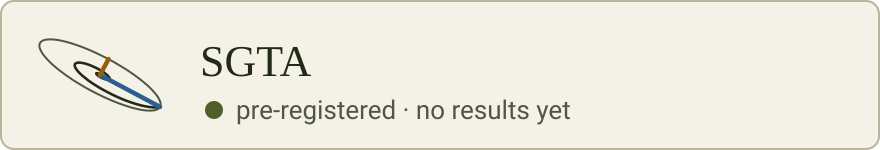
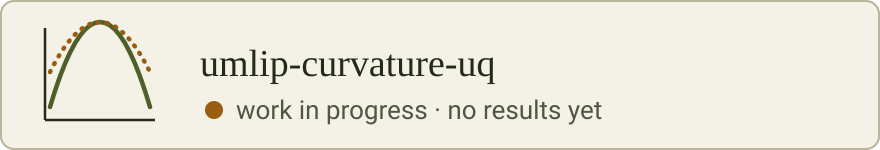
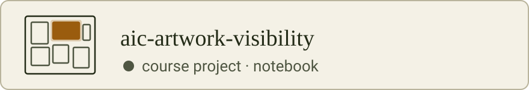

<picture>
  <source media="(prefers-color-scheme: dark)" srcset="assets/hero-dark.svg">
  
</picture>

**Василиса Попова.** Изучаю, где уверенность модели расходится с правдой: поиск ошибок LLM, оценка неопределённости, инструменты для eval. Второй курс, «Математика и компьютерные науки», Центральный университет.

Беру заказы: бэкенды на Python, автоматизации, сайты. [ellischment.ru](https://ellischment.ru) · [ellischment.work@gmail.com](mailto:ellischment.work@gmail.com) · [English](README.md)

*Почему такая картинка.* Линейное отображение одни направления растягивает, другие сжимает, а одна оценка уверенности следует за растянутым. Мой вопрос: что хранят сжатые направления и прячутся ли в них ошибки. Это аналогия для работы, не результат.

## Исследования в работе

<a href="https://github.com/ellischment/sgta"><picture>
  <source media="(prefers-color-scheme: dark)" srcset="assets/strips/sgta-dark.svg">
  
</picture></a>

Отличает ли *устойчивость* скрытого состояния LLM уверенную ошибку от уверенного верного ответа там, где не помогает геометрия состояний? Зафиксированный протокол с порогами и правилами опровержения, код, тесты и CI. Результатов на реальных данных пока нет.

<a href="https://github.com/ellischment/umlip-curvature-uq"><picture>
  <source media="(prefers-color-scheme: dark)" srcset="assets/strips/umlip-curvature-uq-dark.svg">
  
</picture></a>

Видит ли оценка неопределённости по разбросу моделей систематическое занижение частот фононов у универсальных ML-потенциалов? Пайплайн и тесты. Результатов пока нет.

## Законченные работы

<a href="https://github.com/ellischment/llm-trace-eval"><picture>
  <source media="(prefers-color-scheme: dark)" srcset="assets/strips/llm-trace-eval-dark.svg">
  
</picture></a>

Как выглядит eval LLM через трассы OpenTelemetry, а не через один процент accuracy? Небольшой работающий каркас, синтетический датасет на 50 примеров, 15 тестов и CI. Не бенчмарк.

<a href="https://github.com/ellischment/aic-artwork-visibility"><picture>
  <source media="(prefers-color-scheme: dark)" srcset="assets/strips/aic-artwork-visibility-dark.svg">
  
</picture></a>

Какие произведения Art Institute of Chicago останутся невидимыми, если судить только по метаданным? Учебный проект, декабрь 2025: CatBoost и анализ SHAP в одном ноутбуке.

## Как я работаю

- **Тест раньше данных.** В SGTA гипотезы и пороги записаны заранее, CI падает, если протокол изменён без хэша.
- **Говорить, чего нет.** В каждом репозитории перечислено, что не доделано или не реализовано.
- **Упавший вызов не прячет прогон.** В llm-trace-eval ошибка модели становится спаном `ERROR` и неверным ответом, прогон идёт дальше.

## Заказы

Делаю бэкенды, автоматизации и сайты на заказ на Python и Docker. Работы для клиентов закрытые, подробности на [ellischment.ru](https://ellischment.ru).
